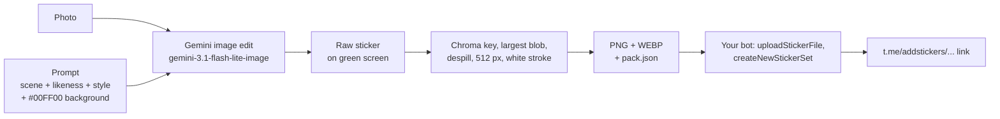

# Telegram Sticker Booth

Turn a selfie into a personalised Telegram sticker pack: one sticker per emoji, in a style you choose, with the pack link sent to you by your own bot. No hand-uploading to @Stickers.

It is a small hobby version of Google's **Sticker Kaki** photo booth: a photo and a prompt go to a Gemini image model, which draws the sticker on a green screen; a few lines of NumPy cut it out, add a white die-cut border and export it at Telegram's 512 px size.


| Gemini output (green screen) | After cleanup (512×512, transparent) |
|---|---|
|  |  |

## How it works



1. **Prompt** (`sticker_booth/prompts.py`). Each emoji has a scene ("laughing so hard tears of joy fly off their face") and a palette. The Sticker Kaki formula adds a likeness clause (keep the real face, hair, glasses), the style, a rule to keep your real clothes and their colours, and *"single continuous thick white die-cut sticker border on a flat #00FF00 background"*.
2. **Generate** (`sticker_booth/generate.py`). The photo, resized to 1024 px, goes to Gemini together with the prompt. Two requests run at a time, transient errors are retried, and stickers that already exist are skipped when you re-run.
3. **Clean up** (`sticker_booth/postprocess.py`). A soft chroma key on "greenness" `G − max(R,B)` keeps the largest blob and fills its holes, so a green shirt survives. It then un-mixes and despills the green fringe, scales evenly to fit 512 px and adds a 10 px white stroke.
4. **Publish** (`sticker_booth/telegram_pack.py`). Your bot uploads every sticker with its emoji, creates the pack (or appends to it) and sends you the link. This part uses only the standard library.

## Setup

You need Python 3.10+ and, for generating images, a Gemini API key with billing or prepaid credit.

**Windows (PowerShell or the Cursor/VS Code terminal)**

```powershell
git clone https://github.com/TanYuanXiangElroy/telegram-sticker-booth.git
cd telegram-sticker-booth
py -m venv venv
venv\Scripts\activate          # if blocked: Set-ExecutionPolicy -Scope CurrentUser RemoteSigned
pip install -r requirements.txt
copy .env.example .env         # then open .env and fill in the keys
```

**Linux / macOS**

```bash
git clone https://github.com/TanYuanXiangElroy/telegram-sticker-booth.git
cd telegram-sticker-booth
python3 -m venv venv
source venv/bin/activate
pip install -r requirements.txt
cp .env.example .env           # then edit .env
```

`.env` is read automatically and is git-ignored. Never commit it or paste keys into a chat.

```ini
GEMINI_API_KEY=...        # https://aistudio.google.com/apikey
TELEGRAM_BOT_TOKEN=...    # from @BotFather
# TELEGRAM_USER_ID=...    # optional, your own id (see below)
```

For the notebook, also run `pip install -r requirements-notebook.txt` and pick the `venv` interpreter as the kernel.

## Docker

If you already have [Docker](https://docs.docker.com/get-docker/) installed, you can run the CLI without a local Python venv. The image does **not** bake in API keys, photos or generated stickers: pass credentials at run time and mount host folders for input/output.

**Build** (from the repo root):

```powershell
# Windows PowerShell
docker build -t sticker-booth .
```

```bash
# Linux / macOS — not tested on those hosts (Windows + Docker Desktop only)
docker build -t sticker-booth .
```

**Runtime layout.** Keep secrets and data on the host:

| Host path | Container path | Purpose |
|---|---|---|
| `.env` | (via `--env-file`) | `GEMINI_API_KEY`, optional Telegram vars — never put these in the Dockerfile |
| `photos/` | `/data/photos` | your selfies (git-ignored) |
| `out/` | `/data/out` | generated stickers |
| `sessions/` | `/app/sessions` | booth session state (edit on the host if you prefer not to use the CLI) |
| `my_prompts.json` | `/app/my_prompts.json` | optional custom prompts (copy from `my_prompts.example.json`) |

Create the host folders first if they do not exist (`photos`, `out`, `sessions`). Copy `.env.example` to `.env` and fill in placeholders only — never commit `.env`.

Linux / macOS Docker commands below are **documented only** (same CLI as Windows). They were **not tested** on Linux or macOS hosts here — only on Windows 10 with Docker Desktop.

**CLI help** (no API call):

```powershell
# Windows PowerShell
docker run --rm sticker-booth sticker_booth.booth --help
docker run --rm sticker-booth sticker_booth.generate --help
docker run --rm sticker-booth sticker_booth.postprocess --help
```

```bash
# Linux / macOS — not tested on those hosts (Windows + Docker Desktop only)
docker run --rm sticker-booth sticker_booth.booth --help
docker run --rm sticker-booth sticker_booth.generate --help
docker run --rm sticker-booth sticker_booth.postprocess --help
```

**Offline conversion** (uses the bundled green-screen fixture; no Gemini key):

```powershell
# Windows PowerShell — write into a host ./out folder
New-Item -ItemType Directory -Force -Path out | Out-Null
docker run --rm -v "${PWD}/out:/data/out" sticker-booth `
  sticker_booth.generate --from-raw examples/sample_raw.png --emojis laugh --out /data/out
# -> ./out/sample_raw/laugh.png and .webp
```

```bash
# Linux / macOS — not tested on those hosts (Windows + Docker Desktop only)
mkdir -p out
docker run --rm -v "$PWD/out:/data/out" sticker-booth \
  sticker_booth.generate --from-raw examples/sample_raw.png --emojis laugh --out /data/out
# -> ./out/sample_raw/laugh.png and .webp
```

**Generate with your photo** (paid Gemini calls — needs billing on the key):

```powershell
# Windows PowerShell
docker run --rm --env-file .env `
  -v "${PWD}/photos:/data/photos" `
  -v "${PWD}/out:/data/out" `
  sticker-booth sticker_booth.generate /data/photos/me.jpg --style pixel --out /data/out
```

```bash
# Linux / macOS — not tested on those hosts (Windows + Docker Desktop only)
docker run --rm --env-file .env \
  -v "$PWD/photos:/data/photos" \
  -v "$PWD/out:/data/out" \
  sticker-booth sticker_booth.generate /data/photos/me.jpg --style pixel --out /data/out
```

**Booth sessions** (also mount `sessions/`):

You can edit booth state on the host instead of only through the CLI. With the mounts below, open these folders/files in Explorer / Finder / your editor:

| Host path | What you can change by hand |
|---|---|
| `sessions/<name>/session.json` | remembered photo path, style, extra text, last pack name |
| `sessions/<name>/previews/` | preview PNGs before approve (delete one to force a redo) |
| `sessions/<name>/approved/` | final `.png` / `.webp` after approve |
| `my_prompts.json` | your custom prompts (start from `my_prompts.example.json`) |

```powershell
# Windows PowerShell
docker run --rm -it --env-file .env `
  -v "${PWD}/photos:/data/photos" `
  -v "${PWD}/out:/data/out" `
  -v "${PWD}/sessions:/app/sessions" `
  -v "${PWD}/my_prompts.json:/app/my_prompts.json" `
  sticker-booth sticker_booth.booth --dry-run list
```

```bash
# Linux / macOS — not tested on those hosts (Windows + Docker Desktop only)
docker run --rm -it --env-file .env \
  -v "$PWD/photos:/data/photos" \
  -v "$PWD/out:/data/out" \
  -v "$PWD/sessions:/app/sessions" \
  -v "$PWD/my_prompts.json:/app/my_prompts.json" \
  sticker-booth sticker_booth.booth --dry-run list
```

On Windows, prefer PowerShell (or Git Bash) so `${PWD}` resolves; classic `cmd.exe` `%cd%` mounts can be awkward with Docker Desktop. Do not `docker cp` secrets into the image or commit a built image that contains `.env`.

## Quick start: the booth

The easiest way in. One command, `python -m sticker_booth.booth`, takes you from a photo to stickers in your pack. Run it with no arguments for an interactive `booth>` prompt, or pass a command as shown below. It remembers your photo, previews and pack in `sessions/<name>/session.json` (git-ignored). Use `--session alice` to keep a friend's run separate.

```bash
python -m sticker_booth.booth photo photos/me.jpg          # once; optional: --extra "..." --style pixel
python -m sticker_booth.booth list                         # numbered menu of all 24 prompts + yours
python -m sticker_booth.booth run 10 11                    # shows the cost, asks, then makes previews
                                                           #   -> sessions/me/previews/10_dragon.png, sheet.png
python -m sticker_booth.booth approve 11                   # -> sessions/me/approved/11_error404.png/.webp
python -m sticker_booth.booth status
python -m sticker_booth.booth add                          # your own prompt (asks name, emoji, scene)
```

* `run` takes numbers, names or emoji, or whole packs: `run 10 11`, `run dragon`, `run dev`, `run all`. `--yes` skips the cost question. Previews that already exist are reused, and `--again` makes new ones.
* The menu numbering stays fixed: classic 1-8, dev 9-12 (9 chope, 10 dragon, 11 error404, 12 please_advise), moods 13-18, reactions 19-24 (24 dogeza). Your own prompts start at 25.
* `add` saves to `my_prompts.json` (git-ignored; see `my_prompts.example.json`), and your prompts use the same template as the built-in ones. Non-interactive form: `add --name duck_ride --emoji 🦆 --scene "riding a giant rubber duck"`.
* **Packs:** if `TELEGRAM_BOT_TOKEN` is set, `approve` looks up your pack: the last one used, or `--pack <name>`. If it finds it, it asks `Add these N sticker(s) to <title>? [y/N]`. If you have no pack yet, it offers to create `booth_<session>_by_<yourbot>`. Uploading also needs `TELEGRAM_USER_ID`. `--no-upload` only saves the files, and `--yes` adds without asking.
* Telegram lets a bot change only the packs **it created**, whose names end in `_by_<yourbot>`. If you name a pack you made in @Stickers, the booth explains this and offers a new pack instead. There is no API to list your packs, so the booth remembers the pack name for you.
* **Try it for free:** `--dry-run` (or no `GEMINI_API_KEY`) goes through the whole flow with the example images and makes no Gemini calls: `python -m sticker_booth.booth --dry-run run 10 11 --yes`.

## Quickstart (the individual tools)

Put your photo in `photos/` (git-ignored). A clear, front-facing, well-lit photo works best.

```bash
# 0. check the prompts and the cost first, which calls nothing
python -m sticker_booth.generate photos/me.jpg --style pixel --dry-run

# 1. photo -> 8 stickers (about $0.27). Writes out/me/{laugh.png,...,pack.json,sheet.png}
python -m sticker_booth.generate photos/me.jpg --style pixel --out out
#    a whole folder works too: python -m sticker_booth.generate photos/ --style pixel
#    just some emojis:         --emojis laugh,cry   (or --emojis 😂,😭)
#    redo one: delete out/me/raw/cry.png and run again with --emojis cry

# 2. look at out/me/sheet.png, then build the pack with your bot
python -m sticker_booth.telegram_pack --whoami        # after pressing Start in your bot's chat
python -m sticker_booth.telegram_pack out/me --user-id <YOUR_ID> --name me_8bit --title "Me 8-Bit" --dry-run
python -m sticker_booth.telegram_pack out/me --user-id <YOUR_ID> --name me_8bit --title "Me 8-Bit" --chat-id <YOUR_ID>
# -> https://t.me/addstickers/me_8bit_by_<yourbot>, also sent to you in a DM
```

Already have a green-screen image, for example one made by hand in the AI Studio web UI? Clean it up without calling the API:

```bash
python -m sticker_booth.postprocess raw.png out/laugh                 # -> out/laugh.png + out/laugh.webp
python -m sticker_booth.generate --from-raw raw.png --emojis laugh --out out   # also writes pack.json + sheet
```

On Windows without activating the venv, use `venv\Scripts\python -m sticker_booth.generate ...`.

### Notebook

[`notebook/sticker_booth.ipynb`](notebook/sticker_booth.ipynb) takes one photo through every stage: the prompt, the Gemini call, the raw image, the chroma key, the cleanup, the contact sheet and an optional upload. It explains each step along the way. With `USE_API = False`, the default, it loads `examples/sample_raw.png`, so it runs top to bottom for free:

```bash
jupyter nbconvert --to notebook --execute notebook/sticker_booth.ipynb --output executed.ipynb
```

## Styles and emojis

| `--style` | look |
|---|---|
| `cartoon` (default) | bold modern 2D cartoon, thick outlines, flat cel-shading, no background scenery |
| `pixel` | Sticker Kaki "8-Bit Retro": pixel grid, crisp pixel edges, bold black outline |
| `cyberpunk` | Sticker Kaki "Cyberpunk": neon glow, circuit and HUD details |

| emoji | name | | emoji | name |
|---|---|---|---|---|
| 😂 | laugh | | 😡 | angry |
| 👍 | thumbs_up | | 🎉 | party |
| ❤️ | heart | | 🤔 | think |
| 😭 | cry | | 😴 | sleep |

The table above is the `classic` pack, the default. `prompts.py` also has a `dev` pack (chope 🧻, dragon 🐉, error404 🏖️, please_advise 😐), a `moods` pack (sad_drink 😔, sad 😞, corner 😶, on_phone 📞, single_tear 🥲, clueless_call 😅) and a `reactions` pack (clown 🤡, skull 💀, shrug 🤷‍♂️, bow 🙇‍♂️, ambulance 🚑, dogeza 🙇). Pick them with `--emojis dev`, `--emojis dev,moods` or `--emojis all`.

To add an emoji or a style, add an entry to `EMOJIS` (file name, scene, palette, optional notes) and to a pack in `PACKS`, or to `STYLES`, in `sticker_booth/prompts.py`. Use `--extra` to add a sentence to every prompt, for example `--extra "Draw only the main person in the photo."` for group photos, or "no background scenery" if a style keeps drawing square panels.

### Optional prompt variations

Off by default: without `--variations`, prompts are exactly the built-in scenes. With `--variations`, the booth appends a seeded pick of pose, expression, props and text-treatment tweaks, plus a likeness / black-hair / skin-tone / chunky-pixel lock. **A seed reproduces those prompt choices only** — Gemini can still draw different pixels on a re-run.

```bash
# inspect prompts only (no API call)
python -m sticker_booth.generate photos/me.jpg --style pixel --emojis laugh --variations --seed 42 --dry-run

# same seed => same prompt text again
python -m sticker_booth.generate photos/me.jpg --style pixel --emojis laugh --variations --seed 42 --dry-run

# omit --seed to pick one and print it (so you can reuse it)
python -m sticker_booth.generate photos/me.jpg --style pixel --emojis dragon --variations --dry-run

# booth front end
python -m sticker_booth.booth run 10 --variations --seed 42 --yes
```

`--seed` without `--variations` is an error. Invalid `--seed` (non-integer) is rejected by argparse.

## Costs and errors

* `gemini-3.1-flash-lite-image` costs about **US$0.034 per image**, so 8 stickers come to about $0.27. Check current pricing; `--dry-run` prints the estimate.
* **HTTP 429** with "limit: 0" / free tier: the free API tier allows **no** image generations. Turn on billing for the key's project. A 429 without "limit: 0" is a rate limit, which is retried automatically.
* **HTTP 402** "Your prepayment credits are depleted": top up at [ai.studio/projects](https://ai.studio/projects).
* The run stops on 402, 429 quota and bad-key errors, and keeps what it finished. Run the same command again to carry on.
* Generating images by hand in the AI Studio web UI and then running `--from-raw` works as a free fallback.

## Telegram rules

* Static stickers are PNG or WEBP with **one side exactly 512 px** and a size of **512 KB** or less. The booth writes 512×512.
* You can't automate the official **@Stickers** bot (it has no API), but **your own bot** can create packs through the Bot API, and the pack belongs to you.
* Create the bot with @BotFather `/newbot`, then press **Start** in its chat. A bot can only make packs for users who have started it, otherwise you get `PEER_ID_INVALID` / "user not found".
* Pack names must end in `_by_<botusername>`, use letters, digits and underscores, start with a letter and be 64 characters at most. Link: `https://t.me/addstickers/<name>`.
* `createNewStickerSet` takes 1 to 50 stickers, `addStickerToSet` adds the rest, and a pack holds at most **120**. Re-running with the same `--name` and extra folders appends only the new stickers, matched by position, so keep the folder order.
* Bots are limited to about 1 message per second per chat. The script waits and honours `retry_after`.
* Only one program may poll `getUpdates` for a token. `--whoami` polls, so don't run it while another bot program uses the same token (409 Conflict).
* Posting into a group topic needs Topics turned on and the bot as an admin with Manage Topics (`--make-topic`, `--chat-id`, `--thread-id`).

## Making stickers of friends

**Ask first.** Only make stickers of people who have agreed, ask before sharing their pack outside your chat, and delete their photos and stickers if they ask. Their photos stay in `photos/` and `out/`, which are git-ignored, so keep it that way and don't commit other people's faces.

## Layout

```
sticker_booth/
  booth.py          photo -> numbered menu -> run / approve -> pack (CLI, start here)
  prompts.py        emoji scenes, styles, prompt template   <- edit me
  generate.py       photo(s) -> Gemini -> stickers (CLI)
  postprocess.py    green screen -> 512 px sticker, contact sheet (CLI)
  telegram_pack.py  stickers -> Telegram pack via your bot (CLI)
  env.py            tiny .env loader
Dockerfile / .dockerignore     optional Docker CLI image (keys & data mounted at run time)
notebook/sticker_booth.ipynb   step-by-step walkthrough
docs/HANDOFF.md                maintenance guide
examples/                      the 8-Bit pack above, plus one raw generation
tests/                         offline unit checks (e.g. variation seeds)
```

## Credits

Inspired by Google's **Sticker Kaki** photo booth, whose prompt formula and the "8-Bit Retro" and "Cyberpunk" style wording this project reuses. Images are generated with Google Gemini. This is an independent hobby project, not affiliated with Google or Telegram. The example stickers are of the author.
